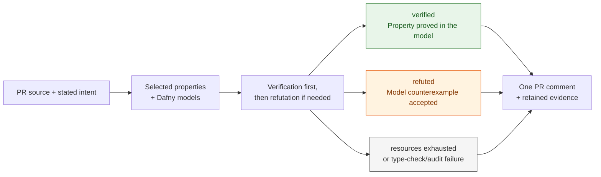

<!-- Copyright (c) Microsoft Corporation.
Licensed under the MIT License. -->

# NFV PR reviewer

A prototype GitHub Agentic Workflow based on
[*Neuro-Formal Verification: Agentic Language-Agnostic Formal Program Reasoning*](https://arxiv.org/abs/2608.21516).

For each eligible PR, NFV reads the change and its stated intent, selects
behavioral properties, and translates relevant source into Dafny. It attempts
verification and refutation, then posts one evidence-linked PR comment.
PR code is inspected as data, never executed.

Audits start when a PR opens non-draft or is marked ready. Later pushes cancel
older attempts without starting another audit; toggle draft to ready to rerun.

Results concern translated models under stated assumptions. Findings are
**conditional MODEL refutations, not confirmed source bugs**; failure to refute
does not establish correctness.

## From a PR to an evidence-linked report

A refutation shows a counterexample input and a sketch of why the modeled
property fails, not an execution trace. Verification shows the checked
property and its assumptions. Both link to source and formal evidence;
neither establishes source-code correctness.

## Report contents

| Report element | What the developer sees |
|---|---|
| Refutation | Property, counterexample input, failure sketch and relevant source |
| Verification | Property, retained assumptions and checked Dafny contract |
| Expandable details | Source context, model evidence and any model-checked candidate fix |
| Evidence links | Captured source and the run's full formal models and diagnostics |

**Installation:** [Onboarding](ONBOARDING.md).

**More:** [Configuration](REFERENCE.md#configure-github-agentic-workflows),
[upgrades](ONBOARDING.md#upgrade-an-existing-installation), and
[technical reference](REFERENCE.md).
