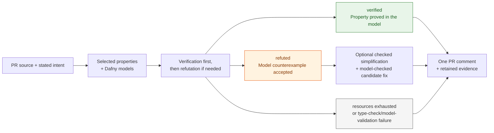

<!-- Copyright (c) Microsoft Corporation.
Licensed under the MIT License. -->

# NFV PR reviewer

A prototype **neuro-formal code review** GitHub Agentic Workflow based on
[*Neuro-Formal Verification: Agentic Language-Agnostic Formal Program Reasoning*](https://arxiv.org/abs/2608.21516).

For each eligible PR, NFV reads the change and its stated intent, selects
behavioral properties, and translates relevant source into Dafny. It attempts
verification and refutation, then posts one evidence-linked PR comment.
PR code is inspected as data, never executed.

Same-repository PRs targeting any branch are eligible; fork PRs are
skipped. Each PR gets one automatic attempt when opened non-draft or marked ready.
Admission records attempts, including failures. Pushes and repeated
ready transitions neither cancel nor repeat it. The saved snapshot is reviewed
even after merge. Retries require an explicit rerun. Both sessions require
`NFV_RELEASE_SHA`.

Results concern translated models under stated assumptions. Findings are
**conditional MODEL refutations, not confirmed source bugs**; failure to refute
does not establish correctness.

## Paper algorithm vs. workflow

The [paper's evaluated algorithm](https://arxiv.org/html/2608.21516#S3) starts
with a supplied source-level assertion. It formalizes library contracts and
documented preconditions without seeing that assertion, then freezes them.
Translation repairs use only syntax/type feedback; subsequent proof search
cannot change frozen computation or contracts. The paper evaluates Dafny proofs
and CBMC bounded refutation.

The workflow instead selects whole properties from PR intent and code. It
jointly formalizes each property with scoped code, input conditions and helper
contracts, allowing bounded draft repairs before freezing. It then tries Dafny
verification first, followed, if needed, by witnessed refutation on the same
frozen model.

For refutations, it tries to **minimize the failure condition** by removing
dispensable assumptions with rechecks and seeking a shorter, separately proved
statement that still fails on the accepted counterexample. Independently, it
searches for a **model-checked candidate fix** that proves the complete original
property without weakening retained assumptions or helper contracts. These
bounded searches do not change the whole property's refuted outcome or guarantee
global minimality or a source-verified repair.

These adaptations aim to improve **review efficiency and strengthen model-level
evidence**. They are not the paper's evaluated pipeline; its experimental results
do not measure workflow accuracy or efficiency.

## From a PR to an evidence-linked report



A refutation shows a counterexample input and a sketch of why the modeled
property fails, not an execution trace. Verification shows the checked
property and its assumptions. Both link to source and formal evidence;
neither establishes source-code correctness.

Reports are bounded by size and URL count; full source and formal evidence remain
in the run artifact when details are compacted.

## Report contents

| Report element | What the developer sees |
|---|---|
| Refutation | Property, counterexample input, failure sketch and relevant source |
| Verification | Property, retained assumptions and checked Dafny contract |
| Expandable details | Source context, model evidence and any model-checked candidate fix |
| Evidence links | Captured source and the run's full formal models and diagnostics |

## Abbreviated report example

This is a **documentation-only abbreviated excerpt** from
[shuvendu-lahiri/nvx#40](https://github.com/shuvendu-lahiri/nvx/pull/40#issuecomment-6511347416)
([run and evidence](https://github.com/shuvendu-lahiri/nvx/actions/runs/40835350142)).
Omissions are marked `...`; original property IDs and refutation-first order
are retained. The published report and proof evidence are unchanged.
Not every refutation includes a model-checked candidate fix.

**These are results for translated models under their stated assumptions, not
proofs of source-code correctness or confirmed source bugs.**

### P4

**Inferred property:** A non-list `layers` value produces the malformed-configuration failure.

**Outcome: refuted**

> A missing field, or a value of the wrong type, fails as `sandbox configuration is malformed`,

**Input on which it fails:** abstract state: kind of the value stored under
`layers` = `1` (object); presence of the `layers` member = `true`; identities
of values yielded while iterating `layers` = `[]`; ...

These are abstract model inputs, not a reconstructed executable configuration.

**Sketch of the failure:** If `layers` is an empty object, `iterate(document, layers_value)?` returns no items; the layer checks are skipped and the remaining valid configuration can be accepted.

**refutation-with-fix (model-checked candidate)**

**Suggested fix:** Require the `layers` node itself to be an array before iterating it, so empty objects and strings cannot be accepted as empty layer lists.

```diff
--- a/nvx-rs/src/host/cli/sandbox/state.rs
+++ b/nvx-rs/src/host/cli/sandbox/state.rs
@@ -615,6 +615,9 @@
     let (launch, shares) = (|| -> std::result::Result<_, Malformed> {
         let root = document.root();
         let layers_value = member(document, root, "layers").ok_or(Malformed::Malformed)?;
+        if !matches!(document.node(layers_value), Node::Array(_)) {
+            return Err(Malformed::Malformed);
+        }
         let mut layers = Vec::new();
         for layer in iterate(document, layers_value)? {
             let layer = layer.ok_or(Malformed::Malformed)?;
```

**Model checks:** The patched model verifies the property with unchanged input assumptions and helper contracts. The counterexample input remains feasible.

**Limits:** The source patch is not applied, compiled or source-verified. ...
The model assumes `layersKind == 0` corresponds exactly to `Node::Array` and
abstracts all downstream calls and error policies. ...

<details><summary>Details</summary>

**Relevant code** (abbreviated; original source line numbers):

```rust
614  pub(crate) fn deserialize_launch(document: &Document) -> Result<SandboxLaunch> {
615      let (launch, shares) = (|| -> std::result::Result<_, Malformed> {
616          let root = document.root();
617          let layers_value = member(document, root, "layers").ok_or(Malformed::Malformed)?;
618          let mut layers = Vec::new();
619          for layer in iterate(document, layers_value)? {
620              let layer = layer.ok_or(Malformed::Malformed)?;
621              if !matches!(document.node(layer), Node::Object(_)) {
622                  return Err(Malformed::Malformed);
623              }
...
```

**Minimized Dafny:** ...

Evidence: `4f3de7703fa63d3a0906/final/model.dfy` in the
[run artifact](https://github.com/shuvendu-lahiri/nvx/actions/runs/40835350142).

</details>

### P1

**Intended property:** For every launch that is serialized successfully, the resulting configuration uses format 7 regardless of whether the launch has shares, and contains an `export` field that is null when the launch has no export plan and is the converted export plan when one is present.

**Outcome: verified**

The property was verified for the translated model.

<details><summary>Verification details</summary>

**Quoted intention:** provision now writes format 7 for every sandbox, with export null for one without shares, and start reads format 7, with export a plan or null

**Assumptions:** No additional input restrictions.

**Environment models:** Represents whether the combined serde_json and python_value conversion of a present network succeeds; its detailed value is irrelevant to the intended property.; ...
For a present export plan, represents whether its serde_json and python_value conversion succeeds and returns the disclosed converted representation.

**Checked property:**

```dafny
ensures success ==> (format == 7 && exportPresent && ((!hasExportPlan ==> exportIsNull) && (hasExportPlan ==> (!exportIsNull && serializedExportPlan == convertedExportPlan))))
```

Evidence: `9d3c24126dc41e5ac780/verification/model.dfy` in the
[run artifact](https://github.com/shuvendu-lahiri/nvx/actions/runs/40835350142).
The full verified Dafny is retained in the linked run artifact.

</details>

**Installation:** [Onboarding](ONBOARDING.md).

The workflows must exist in the target branch/PR merge ref; installing NFV does
not add them to older branches.

<a id="upgrade-an-existing-installation"></a>

**More:** [Configuration](REFERENCE.md#configure-github-agentic-workflows),
[upgrades](ONBOARDING.md#upgrade-an-existing-installation), and
[configuration reference](REFERENCE.md).
For expired tokens and other common problems, see the [FAQ](FAQ.md).

Maintainers: see the [maintenance and local CLI guide](MAINTAINER.md).
The independent [micro-benchmark and its Discussion dashboard](MAINTAINER.md#nightly-nfv-micro-bench)
do not run in client repositories.
