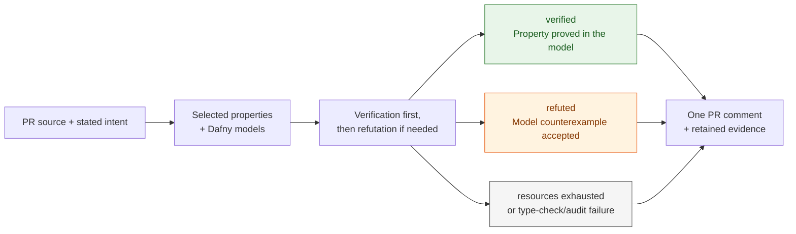
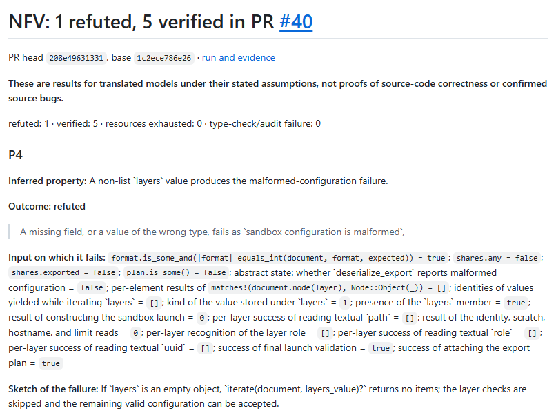

<!-- Copyright (c) Microsoft Corporation.
Licensed under the MIT License. -->

# NFV PR reviewer

A prototype GitHub Agentic Workflow based on
[*Neuro-Formal Verification: Agentic Language-Agnostic Formal Program Reasoning*](https://arxiv.org/abs/2608.21516).

The installer binds the runtime to the installed package's immutable release in
both workflows; upgrades do not require a separate release repository variable.

For each eligible PR, NFV reads the change and its stated intent, selects
behavioral properties, and translates relevant source into Dafny. It attempts
verification and refutation, then posts one evidence-linked PR comment.
PR code is inspected as data, never executed.

Results concern translated models under stated assumptions. Findings are
**conditional MODEL refutations, not confirmed source bugs**; failure to refute
does not establish correctness.

## From a PR to an evidence-linked report



A refutation shows a counterexample input and a sketch of why the modeled
property fails, not an execution trace. Verification shows the checked
property and its assumptions. Both link to source and formal evidence;
neither establishes source-code correctness.

## Example report

This [published report on shuvendu-lahiri/nvx#40](https://github.com/shuvendu-lahiri/nvx/pull/40#issuecomment-6511347416)
contains **1 refuted and 5 verified properties**, with no resource-exhaustion or
type-check/audit failures. The excerpts below preserve the report's property
IDs and text. They are examples from one review, not an estimate of coverage.
The screenshots capture the published GitHub comment, cropped to the report
sections, with verification details expanded.

| Report element | What the developer sees |
|---|---|
| Refutation | Property, counterexample input, failure sketch and relevant source |
| Verification | Property, retained assumptions and checked Dafny contract |
| Expandable details | Source context, model evidence and any model-checked candidate fix |
| Evidence links | Captured source and the run's full formal models and diagnostics |

### P4: Refuted

[](https://github.com/shuvendu-lahiri/nvx/pull/40#issuecomment-6511347416)

> **Inferred property:** A non-list \`layers\` value produces the malformed-configuration failure.
>
> **Outcome: refuted**
>
> **Sketch of the failure:** If \`layers\` is an empty object, \`iterate\(document, layers\_value\)?\` returns no items; the layer checks are skipped and the remaining valid configuration can be accepted.

<details>
<summary>Counterexample input from the report</summary>

**Input on which it fails:** `format.is_some_and(|format| equals_int(document, format, expected)) = true`; `shares.any = false`; `shares.exported = false`; `plan.is_some() = false`; abstract state: whether \`deserialize\_export\` reports malformed configuration = `false`; per-element results of `matches!(document.node(layer), Node::Object(_)) = []`; identities of values yielded while iterating \`layers\` = `[]`; kind of the value stored under \`layers\` = `1`; presence of the \`layers\` member = `true`; result of constructing the sandbox launch = `0`; per-layer success of reading textual \`path\` = `[]`; result of the identity, scratch, hostname, and limit reads = `0`; per-layer recognition of the layer role = `[]`; per-layer success of reading textual \`role\` = `[]`; per-layer success of reading textual \`uuid\` = `[]`; success of final launch validation = `true`; success of attaching the export plan = `true`

</details>

### P1: Verified

[](https://github.com/shuvendu-lahiri/nvx/pull/40#issuecomment-6511347416)

> **Intended property:** For every launch that is serialized successfully, the resulting configuration uses format 7 regardless of whether the launch has shares, and contains an \`export\` field that is null when the launch has no export plan and is the converted export plan when one is present.
>
> **Outcome: verified**
>
> The property was verified for the translated model.

<details>
<summary>Verification details from the report</summary>

**Quoted intention:** provision now writes format 7 for every sandbox, with export null for one without shares, and start reads format 7, with export a plan or null

**Assumptions:** No additional input restrictions.

**Environment models:** Represents whether the combined serde\_json and python\_value conversion of a present network succeeds; its detailed value is irrelevant to the intended property.; Represents whether the combined serde\_json and python\_value conversion of either recorded binding succeeds.; For a present export plan, represents whether its serde\_json and python\_value conversion succeeds and returns the disclosed converted representation.

**Checked property:**

```dafny
ensures success ==> (format == 7 && exportPresent && ((!hasExportPlan ==> exportIsNull) && (hasExportPlan ==> (!exportIsNull && serializedExportPlan == convertedExportPlan))))
```

Evidence: `9d3c24126dc41e5ac780/verification/model.dfy`; SHA-256 `72cba180850521563af5f25f2c4bbb2f22c0a8a3a1cae3580b60ffcf36517af2`.

The full verified Dafny is retained in the linked run artifact.

</details>

Open the [full report](https://github.com/shuvendu-lahiri/nvx/pull/40#issuecomment-6511347416)
for all six properties, source snippets, refutation assumptions and candidate-fix
limitations, or the [run and evidence](https://github.com/shuvendu-lahiri/nvx/actions/runs/40835350142)
for the retained models.

**Installation:** [Onboarding](ONBOARDING.md).

<a id="upgrade-an-existing-installation"></a>

**More:** [Configuration](REFERENCE.md#configure-github-agentic-workflows),
[upgrades](ONBOARDING.md#upgrade-an-existing-installation), and
[technical reference](REFERENCE.md).
