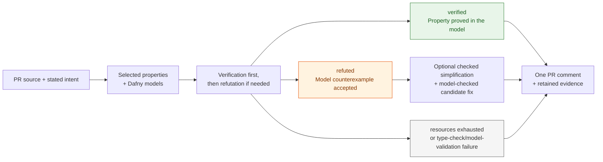
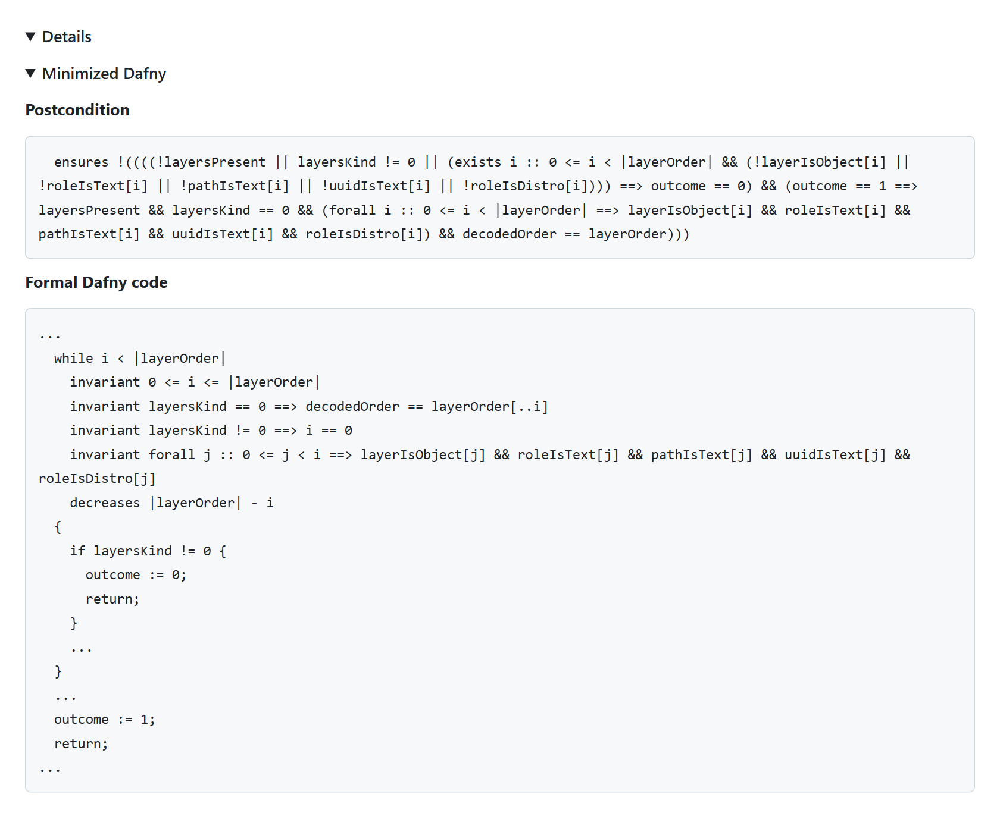
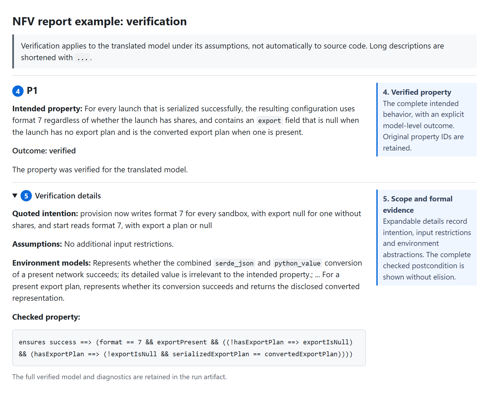

<!-- Copyright (c) Microsoft Corporation.
Licensed under the MIT License. -->

# NFV PR reviewer

A prototype **neuro-formal code review** GitHub Agentic Workflow based on
[*Neuro-Formal Verification: Agentic Language-Agnostic Formal Program Reasoning*](https://arxiv.org/abs/2608.21516).

For each eligible PR, NFV reads the change and its stated intent, selects
behavioral properties, and translates relevant source into Dafny. It attempts
verification and refutation, then posts one evidence-linked PR comment.
PR code is inspected as data, never executed.

Same-repository PRs targeting any branch are eligible; fork PRs are
skipped. Each PR gets one automatic attempt when opened non-draft or marked ready.
Admission records attempts, including failures. Pushes and repeated
ready transitions neither cancel nor repeat it. The saved snapshot is reviewed
even after merge. Retries require an explicit rerun. Both sessions require
`NFV_RELEASE_SHA`.

Results concern translated models under stated assumptions. Findings are
**conditional MODEL refutations, not confirmed source bugs**; failure to refute
does not establish correctness.

## Paper algorithm vs. workflow

The [paper's evaluated algorithm](https://arxiv.org/html/2608.21516#S3) starts
with a supplied source-level assertion. It formalizes library contracts and
documented preconditions without seeing that assertion, then freezes them.
Translation repairs use only syntax/type feedback; subsequent proof search
cannot change frozen computation or contracts. The paper evaluates Dafny proofs
and CBMC bounded refutation.

The workflow instead selects whole properties from PR intent and code. It
jointly formalizes each property with scoped code, input conditions and helper
contracts, allowing bounded draft repairs before freezing. It then tries Dafny
verification first, followed, if needed, by witnessed refutation on the same
frozen model.

For refutations, it tries to **minimize the failure condition** by removing
dispensable assumptions with rechecks and seeking a shorter, separately proved
statement that still fails on the accepted counterexample. Independently, it
searches for a **model-checked candidate fix** that proves the complete original
property without weakening retained assumptions or helper contracts. These
bounded searches do not change the whole property's refuted outcome or guarantee
global minimality or a source-verified repair.

These adaptations aim to improve **review efficiency and strengthen model-level
evidence**. They are not the paper's evaluated pipeline; its experimental results
do not measure workflow accuracy or efficiency.

## From a PR to an evidence-linked report

A refutation shows a counterexample input and a sketch of why the modeled
property fails, not an execution trace. Verification shows the checked
property and its assumptions. Both link to source and formal evidence;
neither establishes source-code correctness.

Reports are bounded by size and URL count; full source and formal evidence remain
in the run artifact when details are compacted.

## Report contents

| Report element | What the developer sees |
|---|---|
| Refutation | Property, counterexample input, failure sketch and relevant source |
| Verification | Property, retained assumptions and checked Dafny contract |
| Expandable details | Source context, model evidence and any model-checked candidate fix |
| Evidence links | Captured source and the run's full formal models and diagnostics |

## Annotated report examples

The comment header summarizes the whole review; P4 and P1 illustrate selected
properties. Numbered callouts explain each part; `...` marks shortened content.
Results concern translated models under stated assumptions, not source-code
correctness or confirmed source bugs.
Not every refutation includes a model-checked candidate fix.

**Installation:** [Onboarding](ONBOARDING.md).

The workflows must exist in the target branch/PR merge ref; installing NFV does
not add them to older branches.

**More:** [Configuration](REFERENCE.md#configure-github-agentic-workflows),
[upgrades](ONBOARDING.md#upgrade-an-existing-installation), and
[configuration reference](REFERENCE.md).
For expired tokens and other common problems, see the [FAQ](FAQ.md).

Maintainers: see the [maintenance and local CLI guide](MAINTAINER.md).
The independent [micro-benchmark and its Discussion dashboard](MAINTAINER.md#nightly-nfv-micro-bench)
do not run in client repositories.
